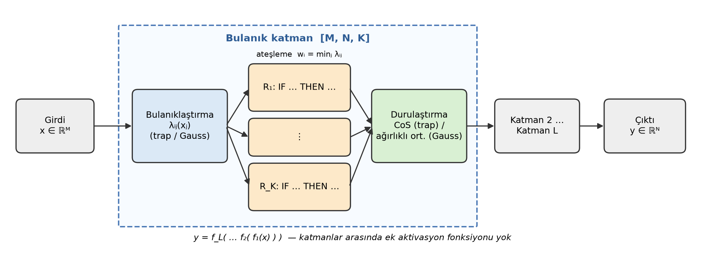

# Fuzzy Rule-Based Network — Reproduction and Extension

> Bulanık Mantık dersi dönem projesi. Durum: **Checkpoint 1–5 ve teknik rapor tamamlandı**; sunum hazırlanıyor. **Rapor: [report/report.pdf](report/report.pdf)** · [Literatür](docs/literatur_taramasi.md) · [Checkpoint 1](docs/checkpoint1_makale_analizi.md) · [Checkpoint 2](docs/checkpoint2_uygulama_plani.md) · [Checkpoint 3](docs/checkpoint3_baseline_sonuclari.md) · [Checkpoint 4](docs/checkpoint4_katki_onerisi.md) · [Checkpoint 5](docs/checkpoint5_deneysel_sonuclar.md)

## Project Title
Fuzzy Rule-Based Network (FRBN): Yorumlanabilir ve Modüler Bulanık Ağın Yeniden Gerçekleştirilmesi ve Geliştirilmesi

## Student Information
| | |
|---|---|
| Ad Soyad | Turan Çaldıran |
| Öğrenci No | 1306220018 |
| Ders | Bulanık Mantık — Dönem Projesi |
| Atanan makale | No. 44 |

## Original Paper
H.-I. Lukács, Á. Smidla, T. Fischl, and J. Botzheim, "Fuzzy rule-based network: a fuzzy logic-based interpretable and modular machine learning model," *Scientific Reports*, vol. 16, Art. no. 34429, 2026, doi: [10.1038/s41598-026-63687-6](https://doi.org/10.1038/s41598-026-63687-6).
Official code: <https://github.com/hunorlukacs/Fuzzy-Network>

## Problem Description
Derin sinir ağları doğru ama yorumlanamaz ("kara kutu"). Klasik bulanık sistemler ve ANFIS ise yorumlanabilir ama derin yapılar kurmaya uygun değil. FRBN, nöron katmanları yerine **bulanık kural katmanları** kullanarak bu iki yaklaşımı birleştiren "gri kutu" bir model öneriyor. Ayrıntılar: [docs/checkpoint1_makale_analizi.md](docs/checkpoint1_makale_analizi.md)

## Method
- Katman `[M, N, K]`: M giriş, N çıkış, K kural; öncüller paylaşımlı (MIMO).
- Üyelik fonksiyonları: trapezoid (a,b,c,d) veya Gauss (μ,σ).
- Kural aktivasyonu: min t-norm.
- Durulaştırma: Mamdani + Center of Sums (trapezoid) / ağırlıklı merkez ortalaması (Gauss).
- Eğitim: Adam, Levenberg–Marquardt (trust region), BEA/BMA.

## Fuzzy System Architecture


| Modül | Görev |
|---|---|
| [src/membership.py](src/membership.py) | Trapezoid (Denk. 2–3) ve Gauss (Denk. 7) üyelik fonksiyonları |
| [src/fuzzy_layer.py](src/fuzzy_layer.py) | `FuzzyLayer [M,N,K]`: min t-norm, Center of Sums (Denk. 5–6), ağırlıklı ortalama (Denk. 9) |
| [src/fuzzy_network.py](src/fuzzy_network.py) | `FuzzyNetwork`: katmanların zincirlenmesi (Denk. 10), parametre sayımı, kuralların yazdırılması |
| [src/data.py](src/data.py) | sinc / trigonometrik veri üreticileri, 5-katlı bölme |
| [src/nn_baseline.py](src/nn_baseline.py) | Karşılaştırma için tek gizli katmanlı MLP (1-20-1 = 61 parametre) |
| [src/optim_lm.py](src/optim_lm.py) | Levenberg–Marquardt: standart ve trust-region sönümleme (Denk. 15–19) |
| [src/train.py](src/train.py) | Eğitim döngüsü (Adam / LM / LM-TR), early stopping, 5-katlı CV, özet istatistikler |
| [src/initialization.py](src/initialization.py) | **Önerilen katkı:** FCM / kantil ızgarası tabanlı kapsama-bilinçli kural başlatma, ölü kural ve kapsama tanılaması |
| [src/experiment.py](src/experiment.py) | Deney altyapısı: CV, başlatma protokolleri, tablo ve grafik üretimi |

```python
from src.fuzzy_network import FuzzyNetwork
net = FuzzyNetwork([[3, 1, 7]], ante="trap", cons="trap", seed=0)
print(net.summary()); print("\n".join(net.rules()))
```

## Dataset
- **sinc:** sentetik, 20.000 nokta (kodla üretilir).
- **Trigonometrik:** y = sin(2πx₂)·cos(2πx₃), x₁ gürültü, 8000 örnek (kodla üretilir).
- MEMS endüstriyel veri seti bu projenin kapsamı dışındadır (gerekçe raporda).

## Installation
```bash
git clone <repo-url>
cd fuzzy-logic-project
python -m venv .venv
.venv\Scripts\activate        # Windows  (Linux/macOS: source .venv/bin/activate)
pip install torch==2.15.0 --index-url https://download.pytorch.org/whl/cpu
pip install -r requirements.txt
```

## Requirements
Python 3.14.5, PyTorch 2.15.0 (CPU). Sabitlenmiş sürümler: [requirements.txt](requirements.txt).

## How to Run
```bash
python -m src.data                         # veri setlerini üretip özetini yazdırır
python -m pytest -q                        # testleri çalıştırır
python -m experiments.baseline.e1_sinc     # E1: sinc, FN vs NN (~25 dk, CPU)
python -m experiments.baseline.e2_trig     # E2: trigonometrik veri, [3,1,7] FN
python -m experiments.baseline.e1b_init_sensitivity   # E1b: 20 başlatma tohumu, yakınsama oranı
```
Her betik `--quick` ile birkaç saniyelik bir deneme modunda da çalışır. Çıktılar `results/tables/` (CSV + Markdown özet) ve `results/figures/` (PNG) altına yazılır.

## Reproduction Experiments
| Deney | Makale | Bizim |
|---|---|---|
| sinc, FN Gauss LM-TR, val. MSE en iyi | 6.20e-8 | 1.05e-7 (E1), 1.79e-8 (E1b) |
| sinc, FN Gauss LM-TR, yakınsama oranı | raporlanmamış | 9/20 başlatma (E1b) |
| sinc, NN tanh LM-TR, val. MSE ort. | 2.82e-7 | 1.68e-7 |
| sinc, FN Trap Adam, val. MSE ort. | 2.24e-3 | 1.86e-3 |
| Trig `[3,1,7]`, LM-TR, val. MSE ort. | 1.09e-2 | 2.78e-2 |
| Trig `[3,1,7]`, Adam, val. MSE ort. | 5.38e-2 | 1.99e-2 |

Ayrıntılar, farklar ve olası nedenleri: [docs/checkpoint3_baseline_sonuclari.md](docs/checkpoint3_baseline_sonuclari.md).

## Proposed Extension
**Kapsama-bilinçli (FCM tabanlı) kural başlatma.** Rastgele başlatma kuralları veri üzerine dengesiz dağıtıyor: bazıları aralık dışında kalıyor, bazıları üst üste yığılıyor, bazıları hiç ateşlenmiyor (ölü kural; gradyanı sıfır). Yerel bir yöntem olan LM bunu düzeltemiyor (sinc'te FN + LM-TR yalnızca 9/20 başlatmada yakınsıyor). Önerilen yöntem ilk katmanın kurallarını Fuzzy C-Means ile (giriş uzayında `fcm` ya da ürün uzayında `fcm_xy`) verinin üzerine yerleştiriyor; `lhs` kümeleme yapmayan bir kontrol yöntemi. Kod: [src/initialization.py](src/initialization.py) · Öneri ve pilot sonuçlar: [docs/checkpoint4_katki_onerisi.md](docs/checkpoint4_katki_onerisi.md)

Pilot (fold 0, LM-TR): sinc'te yakınsama 3/8 (random) → 8/8 (fcm); trigonometrik veride medyan val. MSE 3.6e-2 (random) → 1.6e-3 (fcm_xy).

## Experimental Results
| Performans ölçütü | Baseline (random) | Önerilen (fcm) | Değişim |
|---|---|---|---|
| sinc, LM-TR yakınsama oranı (20 başlatma) | 9/20 | **20/20** | +55 puan (Fisher p < 0.001) |
| sinc, LM-TR medyan val. MSE | 1.98e-3 | **1.05e-7** | ~19.000× düşük (Wilcoxon p < 0.001) |
| sinc, Gauss LM-TR 5-katlı CV | 3.24e-3 ± 6.2e-3 | **1.12e-7 ± 8.4e-8** | makale: 8.07e-7 ± 5.8e-7 |
| trig, LM ort. val. MSE (10 çift) | 2.33e-2 | **6.20e-3** | 3.8× düşük (p = 0.014) |
| trig, eğitim sonunda ölü kural | 1.0 | **0** | — |
| toplam süre (başlatma + eğitim) | — | — | +%19–27 (FCM); lhs ile ihmal edilebilir |

Kümeleme yapmayan `lhs` kontrolü çoğu durumda `fcm` kadar iyi. Kazancın asıl kaynağı **kapsama**. FCM'nin 3 boyutta bazı örnekleri kapsamaması, LM-TR'deki anlamsız sonucu açıklıyor. Ayrıntılar, istatistikler ve tartışma: [docs/checkpoint5_deneysel_sonuclar.md](docs/checkpoint5_deneysel_sonuclar.md) · tüm tablolar: [results/tables/p_summary.md](results/tables/p_summary.md)

```bash
python -m experiments.proposed.p1_convergence   # P1: 20 başlatma, yakınsama oranı (~30 dk)
python -m experiments.proposed.p2_sinc_cv       # P2: sinc 5-katlı CV (~30 dk)
python -m experiments.proposed.p3_trig_cv       # P3/P4: trig + yorumlanabilirlik (~20 dk)
python -m experiments.proposed.p_analysis       # istatistik, tablolar, şekiller
python -m experiments.proposed.p6_rules         # P6: eğitilmiş kuralların dilsel yorumu
```

**Kural yorumlama örneği (P6, trigonometrik veri, FCM başlatma):** eğitilmiş 7 kuralın 6'sı gerçek veriyle yön olarak tutarlı, ölü kural yok; ör. `EĞER x₂ Düşük VE x₃ Orta İSE y Düşük`. Tablo: [results/tables/p6_rules.csv](results/tables/p6_rules.csv)

## Technical Report
- PDF: [report/report.pdf](report/report.pdf) (11 sayfa; kaynakça hariç ~9,7 sayfa, IEEE kaynakça, 25 doğrulanmış kaynak)
- Rapor betikle üretilir; tablolar doğrudan `results/tables/*.csv` dosyalarından okunur:
```bash
python -m report.make_figures      # mimari diyagramı + başlatma karşılaştırma şekli
python -m report.build_report      # report/report.docx
# PDF: report.docx'i Word'de açıp Farklı Kaydet > PDF (ya da report/export_pdf.ps1)
```

## Limitations
- Deneyler 1 ve 3 boyutlu sentetik verilerle sınırlı; makaledeki MEMS verisi ve yüksek boyutlu gerçek veri test edilmedi.
- Bakteriyel memetik algoritma (BMA) kapsam dışında; Adam, LM ve LM-TR karşılaştırıldı.
- Yalnızca tek katmanlı FN'ler denendi; çok katmanlı ağlarda yalnızca ilk katman veriden başlatılabiliyor.
- FCM'nin genişlikleri 3 boyutta kapsamayı garanti etmiyor (trig'de doğrulama örneklerinin %6'sı kapsanmıyor).
- Kısıtsız eğitimde sonuç kümeleri çıkış aralığının dışına taşabiliyor; kuralların sonuç etiketleri ancak yön olarak yorumlanabiliyor.
- Trigonometrik verideki y normalizasyonu makalede belirtilmediği için o deneyin makaleyle mutlak karşılaştırması temkinli yorumlanmalı.

## References
Bkz. [references/README.md](references/README.md).

## Code Provenance and AI Usage
- `src/` ve `experiments/` altındaki kod bu proje kapsamında yazılmıştır; resmi depodan kod kopyalanmamıştır (resmi depo yalnızca makalede yazmayan ayrıntılar için referans olarak okunmuştur). Dışarıdan bir parça alınırsa dosya başında kaynak gösterilerek işaretlenecektir.
- Kodun ve belgelerin hazırlanmasında üretken yapay zekâ desteği kullanılmıştır; ayrıntılar raporun "Generative AI Usage Disclosure" bölümünde beyan edilecektir.
